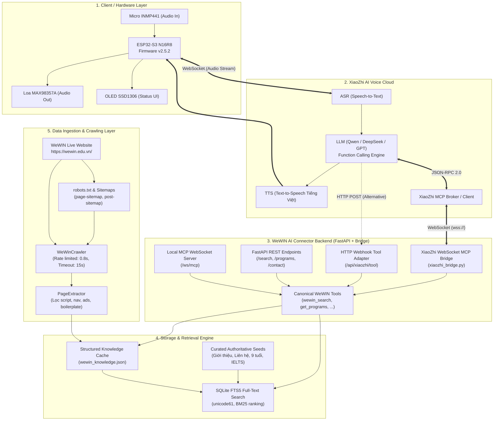
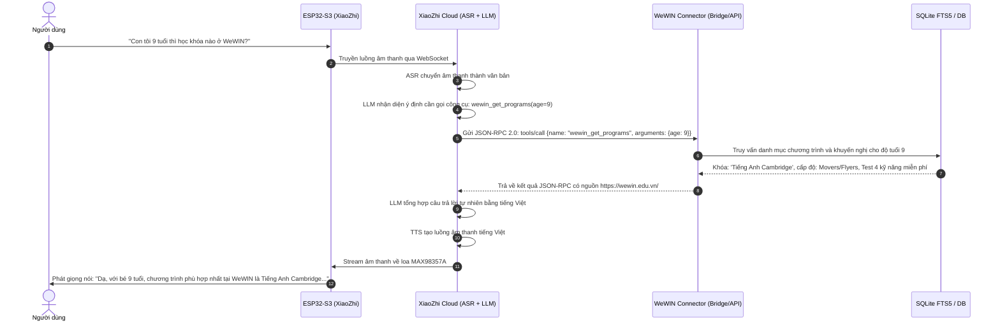

# System Architecture: WeWIN AI Website Connector

Tài liệu thiết kế kiến trúc toàn diện cho hệ thống tích hợp trợ lý giọng nói **XiaoZhi ESP32-S3** với nguồn dữ liệu website **WeWIN Education** ([https://wewin.edu.vn/](https://wewin.edu.vn/)).

---

## 1. Tổng quan kiến trúc hệ thống

Hệ thống được thiết kế theo mô hình **Decoupled Edge-Cloud-Connector Architecture**, tách biệt hoàn toàn giữa phần cứng ESP32, dịch vụ hội thoại AI (XiaoZhi Cloud / LLM) và dịch vụ xử lý dữ liệu WeWIN.

---

## 2. Luồng xử lý một truy vấn giọng nói (End-to-End Sequence)

Giả sử người dùng bấm nút hoặc đánh thức ESP32 và nói: **"Con tôi 9 tuổi thì học khóa nào ở WeWIN?"**

---

## 3. Các thành phần chính (Components Specification)

### 3.1. Crawler & Extractor (`src/crawler/`)
* **`sitemap_crawler.py`**:
  - Tự động đọc `robots.txt` và sitemaps (`page-sitemap.xml`, `post-sitemap.xml`).
  - Lọc bỏ các URL không chứa nội dung đào tạo (ví dụ: giỏ hàng, thanh toán, tài khoản, game flash).
  - Có cơ chế **Polite Crawling**: delay `0.8s` giữa các request, timeout `15s`, ghi nhận lỗi mạng mà không làm dừng tiến trình.
* **`extractor.py`**:
  - Loại bỏ hoàn toàn các thẻ rác: `script`, `style`, `nav`, `header`, `footer`, `aside`, `form`, iframe quảng cáo.
  - Xử lý triệt để ngoại lệ cấu trúc DOM (BeautifulSoup detached nodes).
  - Chuẩn hóa văn bản thành khối thuần túy, loại bỏ các dòng lặp lại.
* **`curated_seeds.py`**:
  - Chứa bộ tri thức nền tảng có độ tin cậy tuyệt đối (100% ground truth) được trích xuất trực tiếp từ các tài liệu và phần giới thiệu chính thức của WeWIN Education.
  - Đảm bảo hệ thống luôn luôn trả lời đúng ngay cả khi website đang bảo trì.

### 3.2. Storage & Search Engine (`src/storage/db.py`)
* Sử dụng **SQLite FTS5** tích hợp sẵn trong Python.
* Tokenizer: `unicode61` (hỗ trợ phân tách từ tiếng Việt, không bị lỗi dấu Unicode).
* Thuật toán xếp hạng: **BM25 (Best Matching 25)** tự động đánh giá mức độ tương quan giữa câu hỏi của người dùng và các bài viết.
* Cơ chế **Snippet Extraction**: tạo đoạn trích dẫn chứa từ khóa tìm kiếm để gửi vào context của LLM.

### 3.3. FastAPI Service (`src/api/`)
* Khung REST API bất đồng bộ tốc độ cao.
* Cung cấp các endpoint:
  - `GET /health`: Giám sát sức khỏe hệ thống.
  - `GET /search`: Tìm kiếm có phân trang và xếp hạng.
  - `GET /programs`: Cung cấp danh mục khóa học và tư vấn độ tuổi.
  - `GET /contact`: Thông tin hotline, email, địa chỉ cơ sở.
  - `POST /sync`: Đồng bộ lại dữ liệu (yêu cầu Admin Token).
  - `POST /api/xiaozhi/tool`: Webhook tương thích mọi dịch vụ AI hỗ trợ HTTP Tool Calling.

### 3.4. XiaoZhi MCP Integration (`src/mcp/`)
Hỗ trợ cả 3 hình thức kết nối phổ biến nhất trong hệ sinh thái XiaoZhi:
1. **XiaoZhi Cloud WebSocket Bridge (`xiaozhi_bridge.py`)**:
   - Kết nối tới `wss://api.xiaozhi.me/mcp/...`
   - Đăng ký công cụ qua `tools/list`
   - Nhận yêu cầu và trả kết quả qua `tools/call`
   - Tự động kết nối lại khi mất mạng (exponential backoff).
2. **Local WebSocket MCP Server (`mcp_server.py`)**:
   - Mở cổng `ws://localhost:8000/ws/mcp` cho phép các MCP client kết nối trực tiếp.
3. **HTTP Webhook Adapter (`routes.py`)**:
   - Dành cho các phiên bản XiaoZhi hoặc nền tảng bot gọi công cụ qua HTTP POST.

---

## 4. Thiết kế nguyên tắc phòng chống ảo giác (Anti-Hallucination Design)

Để đảm bảo AI không tự bịa thông tin:
1. **Nguồn gốc rõ ràng**: Mọi kết quả tìm kiếm và công cụ đều trả kèm `source_url` từ `wewin.edu.vn`.
2. **Học phí minh bạch**: Vì website WeWIN không niêm yết mức học phí cố định do phụ thuộc vào bài test đầu vào của từng học viên, hệ thống được cấu hình để **nói rõ điều này** và khuyến khích phụ huynh đăng ký buổi test 4 kỹ năng miễn phí hoặc gọi hotline.
3. **Không suy đoán độ tuổi ngoài phạm vi**: Nếu hỏi độ tuổi dưới 3 tuổi, hệ thống thông báo rõ WeWIN chỉ nhận từ 3 tuổi trở lên.

---

## 5. Khả năng mở rộng tương lai (Future Extensibility)

Kiến trúc đã được thiết kế sẵn sàng để mở rộng thêm các kênh nội dung khác mà không cần cấu trúc lại backend:
* **Mở rộng kênh YouTube của WeWIN**: Thêm module `src/crawler/youtube_crawler.py` sử dụng `yt-dlp` hoặc YouTube Data API để bóc tách transcript bài giảng video và đưa vào bảng `pages_fts` với `category='youtube'`.
* **Mở rộng sang Facebook / Zalo OA**: Bổ sung seed data hoặc webhook từ kênh tư vấn tuyển sinh.
