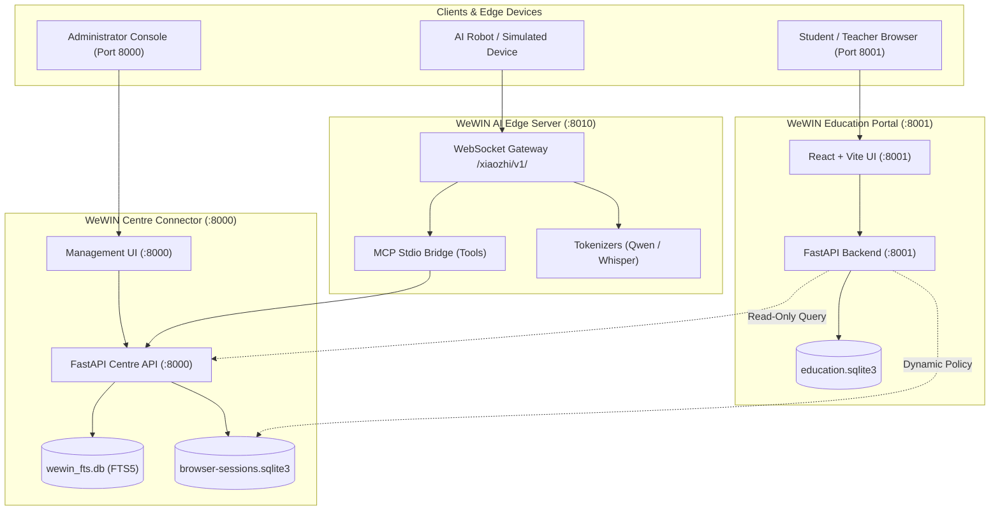

# WeWIN Education AI Robot Platform - Architecture Specification

## 1. Monorepo Architecture Overview

The **WeWIN Education AI Robot Platform** is engineered as a unified, modular monorepo containing three coordinated service domains:
1. **Education Management & Portal** (`portal/`): User accounts, role-based access control (Admin, Teacher, Student, Guardian), curriculum lessons, homework OCR grading, and AI persona authoring.
2. **WeWIN Centre & MCP Connector** (`connector/`): Knowledge base indexing (SQLite FTS5), official course media catalogs, device enrollment store, and Model Context Protocol (MCP) server for robot AI assistants.
3. **Local AI Streaming Runtime** (`portal/ai_server/`): WebSocket-based real-time voice & LLM streaming engine, tokenizers (Qwen3, Qwen2.5, Whisper), and device state synchronization.

---

## 2. Port Allocations & Network Topology

| Port | Protocol | Service | Default Bind | Purpose |
| :--- | :--- | :--- | :--- | :--- |
| **8000** | HTTP / WebSocket | WeWIN Centre Connector | `127.0.0.1` | Knowledge base search, media registry, device auth & management |
| **8001** | HTTP | WeWIN Education Portal | `127.0.0.1` | Main learning platform, lesson practice, student progress, RBAC |
| **8010** | HTTP / WebSocket | WeWIN AI Server | `127.0.0.1` | Streaming voice interactions, MCP tool execution, WebSocket edge |
| **8013** | HTTPS / TLS | Device Edge TLS | `127.0.0.1` | Optional hardware edge TLS termination for test bench |

---

## 3. Data Storage & Schema Isolation

The platform enforces strict physical and transactional separation between databases:

### A. Portal Database (`portal/data/education.sqlite3`)
- **Users & Profiles**: User accounts, passwords (PBKDF2-HMAC-SHA256), roles (`admin`, `teacher`, `student`, `guardian`).
- **Curriculum**: Lessons, modules, learning paths, practice exercises, answer grading keys.
- **Learning Sessions**: Student practice attempts, scores, time spent, completed lessons.
- **AI Roles & Personas**: Configurable AI assistant roles (`Win`, `Coach`, `Tutor`), speech styles, prompts.
- **Audit Logs**: Immutable log of administrative actions and role assignments.

### B. Knowledge Database (`connector/data/wewin_fts.db`)
- **SQLite FTS5 Full-Text Search**: Indexed articles, programs, courses, tuition policies, FAQs.
- **Publication Policy**: Automated classification ensuring only strictly public information is exposed via MCP.

### C. Device Store (`connector/.secrets/browser-sessions.sqlite3` / Fixture)
- **Device Identities**: Registered robots, wire IDs, MAC addresses, firmware versions.
- **Observations**: Heartbeat telemetry, online state, native MCP bridge state.
- **Offline Fixture**: When cloned to a new PC without production secrets, the system automatically falls back to `portal/tests/fixtures/fixture_browser_sessions.sqlite3` to provide a mock classroom robot for offline demonstrations.

---

## 4. Security & Isolation Boundaries

1. **Local Loopback by Default**: All services bind to `127.0.0.1` unless explicitly instructed via `WEWIN_BIND_ADDRESS`.
2. **Secret Redaction**: API keys and tokens are never returned in cleartext to web browsers or logs.
3. **No Robot Hardware Dependency**: Software developers and educators can operate 100% of the portal, curriculum, and AI persona features using simulated devices and mock fixtures.
